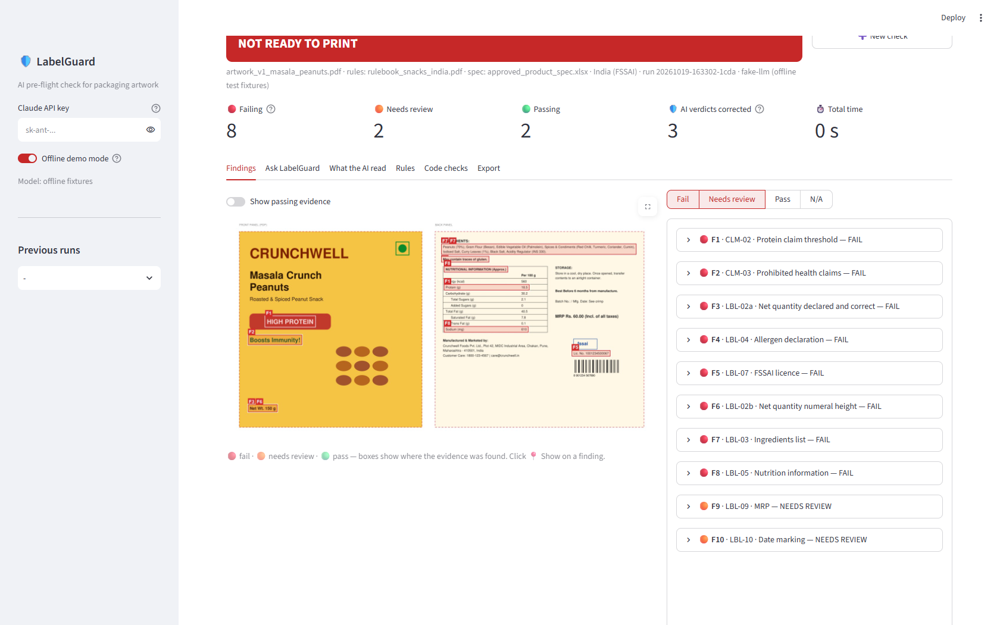
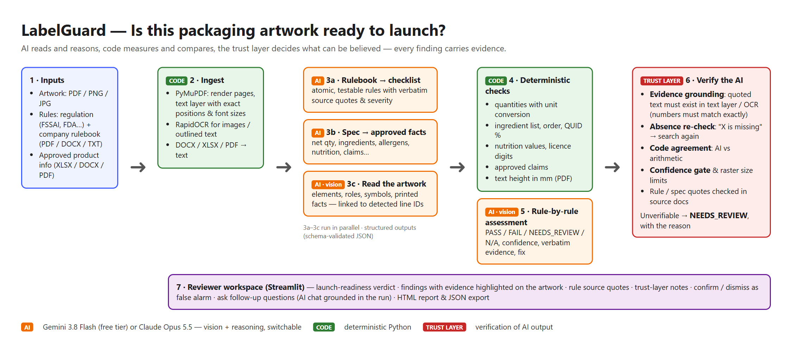
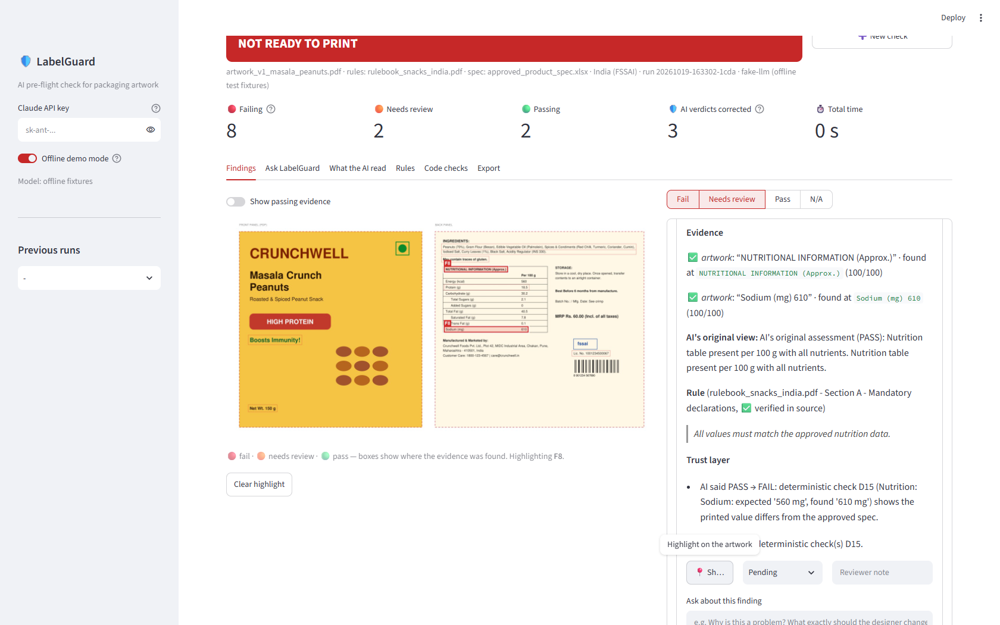

# 🛡️ LabelGuard — is this packaging artwork ready to launch?

**Esko AIForge 2026 · Theme 2: "Is this Packaging Artwork ready to launch?"**

LabelGuard is an AI-powered pre-flight checker for packaging artwork. Give it the artwork, the rules it must follow (a regulation such as FSSAI / FDA and/or a company rulebook) and the approved product information. It reports, rule by rule, **what is correct, what is wrong, and what a human needs to verify**. Every finding shows the evidence, highlighted on the artwork.

The core design choice is that **the AI is never trusted blindly**. A vision model (Google Gemini by default, free tier, or Anthropic Claude) reads the artwork and reasons about the rules. Deterministic code measures and compares values. A *trust layer* then checks every AI claim against independent evidence and downgrades anything it cannot verify to **NEEDS REVIEW**, together with the reason.



---

## What it does

| Step | Who | What |
|---|---|---|
| 1. Read the rulebook | AI | Turns regulations / rulebooks (PDF, DOCX, TXT) into atomic, testable rules with severity and a **verbatim source quote** |
| 2. Read the approved spec | AI | Extracts approved facts (net quantity, ingredients, allergens, nutrition, licence, claims, ...) from XLSX / DOCX / PDF |
| 3. Read the artwork | AI (vision) + code | The AI identifies every element on the artwork. PyMuPDF / RapidOCR independently extract each text line with its exact position and size |
| 4. Cross-check | Code | Compares artwork with spec: quantities with unit conversion, ingredient list order and QUID %, nutrition values, licence digits, approved claims. Measures text height in mm from the PDF |
| 5. Assess every rule | AI (vision) | PASS / FAIL / NEEDS_REVIEW / N/A, with confidence, verbatim evidence, reasoning and a suggested fix |
| 6. Verify the AI | Trust layer | Grounds quotes, re-checks "missing" claims, enforces agreement with the code, applies confidence gates (details below) |
| 7. Review | Human | Launch-readiness verdict, evidence boxes on the artwork, confirm / dismiss as false alarm, follow-up chat, HTML report |



## How it handles uncertainty and wrong AI output

The submission guideline asks for *"thoughtful handling of uncertainty and incorrect AI outputs"*. This is the centre of LabelGuard's design, not an add-on.

| Failure mode of the AI | What LabelGuard does |
|---|---|
| **Misreads or invents text** ("MRP ₹ 60/-" when the pack says "MRP Rs. 60.00") | Every quote is located in the PDF text layer / OCR with a fuzzy matcher that is **strict on numbers** ("200 g" never matches "150 g"). If the quote can't be found, no box is drawn on the artwork and the verdict becomes NEEDS REVIEW |
| **Hallucinated absence** ("Best Before is missing") | Claims of absence are re-searched on the artwork. If the text is found → NEEDS REVIEW, marked *possible false alarm*, with its location |
| **Misses a value mismatch** (says nutrition is fine; sodium is 610 mg vs 560 mg approved) | Deterministic checks compare values arithmetically. For value-matching rules **code beats AI**: PASS → FAIL, and the exact table row is highlighted |
| **Over-confident visual judgement** | Low-confidence PASS/FAIL, and visual FAILs below 0.8 confidence, go to NEEDS REVIEW |
| **Can't measure physical size from a photo** | Size rules (e.g. "net quantity numerals ≥ 4 mm") are measured from the PDF text layer. On raster images they are routed to a human |
| **Paraphrases the rule** | Each rule's source quote is verified against the rulebook text and flagged if not found verbatim |
| **Misses a problem entirely** | Spec mismatches found by code but not linked to any rule are raised as findings of their own |

Every adjustment is written into the finding's **trust notes**, and the header shows how many AI verdicts were corrected. Reviewers can then **confirm** or **dismiss as false alarm**; the launch-readiness verdict and the report update to match.



## Quick start

Requires Python 3.11 or newer. **Windows shortcut:** double-click `run.bat`. It sets everything up on the first run and starts the app.

```bash
git clone <this repo> && cd esko-labelguard
python -m venv .venv
.venv\Scripts\activate          # Windows   (macOS/Linux: source .venv/bin/activate)
pip install -r requirements.txt
copy .env.example .env          # then add your key (macOS/Linux: cp)
streamlit run app.py
```

**API key:** get a free Gemini key at https://aistudio.google.com/apikey and set `GEMINI_API_KEY=` in `.env` (or paste it in the sidebar). To use Claude instead, set `ANTHROPIC_API_KEY` and `LABELGUARD_PROVIDER=claude`.

Open http://localhost:8501, switch on **Use the bundled sample files**, and click **Run pre-flight check**.

- **See real results instantly, without a key:** in the sidebar, under **Previous runs**, open one of the three *recorded examples*. These are real Gemini runs on the sample files, shipped in `samples/recorded_runs/`.
- **No API key?** Turn on **Offline demo mode** in the sidebar. The AI steps return canned responses for the bundled v1 sample, and everything else (ingestion, OCR, deterministic checks, trust layer, UI) runs for real. The canned responses include three deliberate AI mistakes, so you can watch the trust layer catch them.
- Rerunning the same files is instant: AI responses are cached in `data/cache/` (set `LABELGUARD_CACHE=0` to disable).
- Tests: `pytest -q` (27 tests, fully offline).
- Works with python.org Python and Anaconda on Windows, macOS and Linux. Anaconda ships an old C++ runtime that crashes onnxruntime on Windows; LabelGuard works around it automatically (`labelguard/__init__.py`).

## Deploy a shareable link (Streamlit Community Cloud, free)

1. Push this folder to a **public** GitHub repository. `.env` is git-ignored, so your key is never uploaded.
2. Go to https://share.streamlit.io, sign in with GitHub, click **Create app**, and choose the repository, branch `main` and file `app.py`.
3. Under **Advanced settings**, choose **Python 3.12**. In **Secrets**, paste:
   ```toml
   GEMINI_API_KEY = "your-gemini-key"
   APP_ACCESS_CODE = "pick-a-code"   # optional: only people with the code can use your key
   ```
4. Click **Deploy**. The first build takes a few minutes, and you get a link like `https://<name>.streamlit.app`.

Visitors without the access code can still open the recorded examples, use offline demo mode, or paste their own free Gemini key. Note that a hosted app's disk is temporary: AI responses cached there are lost when the app restarts.

## Sample files

`samples/` contains a realistic, fictitious test case. Regenerate it with `python scripts/make_samples.py`.

| File | What it is |
|---|---|
| `artwork_v1_masala_peanuts.pdf` | Snack pouch artwork (front + back panel) with **7 planted errors** |
| `artwork_v1_masala_peanuts.png` | Same artwork as a raster image → exercises the OCR path |
| `artwork_v2_masala_peanuts_fixed.pdf` | Corrected artwork |
| `rulebook_snacks_india.pdf` | Company rulebook interpreting FSSAI labelling rules (17 rules) |
| `approved_product_spec.xlsx` | Approved product information + nutrition sheet |

Answer key for v1: ① net quantity 150 g vs approved 200 g · ② net quantity numerals ≈ 2.3 mm (rule: ≥ 4 mm) · ③ Peanuts 70 % vs 72 % (QUID) · ④ no "Contains: Peanuts" allergen statement, only "May contain" · ⑤ sodium 610 mg vs 560 mg · ⑥ licence number has 13 digits and does not match · ⑦ unapproved "HIGH PROTEIN" claim (18.5 g < 20 g) and prohibited "Boosts Immunity!" claim.

LabelGuard is not limited to this sample. It works on any artwork, rulebook and spec, including the samples provided by Esko.

## AI models and technologies

| Component | Technology | Why |
|---|---|---|
| Vision + reasoning | **Google Gemini 3.8 Flash** (`gemini-3.8-flash`, free tier) via the `google-genai` SDK; **Claude Opus 5.5** (`claude-opus-5-5`) as an alternative provider | Reads artwork images and long rulebooks, and reasons about rules. The provider is a setting; the rest of the system doesn't change |
| Reliable AI output | **Structured outputs**: every AI step must return a JSON schema generated from Pydantic, and is validated again on receipt (one automatic repair retry) | No free-text parsing; each claim is machine-checkable |
| Robustness | Per-step thinking/effort levels (high for artwork reading and assessment), high image resolution for small label text, automatic retry on free-tier rate limits, on-disk response cache | Spend and latency go where accuracy matters; demos re-run instantly |
| PDF | **PyMuPDF** | Renders pages; the text layer gives exact positions and font sizes → mm measurements |
| OCR | **RapidOCR** (PaddleOCR models on ONNX Runtime) | Independent second reader for raster artwork and outlined text; pip-only |
| Matching | **RapidFuzz** + number-strict normalisation | Grounds AI quotes; tolerant of OCR spacing and l/I confusion, intolerant of wrong numbers |
| Documents | python-docx, openpyxl / pandas | Rulebooks and specs in common office formats |
| UI | **Streamlit** | Reviewer workspace, chat, report export |

Technology choice earns no points by itself, so each AI step does only what code can't do, and code does everything that can be verified.

## Project structure

```
app.py                     Streamlit reviewer UI
labelguard/
  pipeline.py              orchestration (ingest → 3 parallel AI reads → checks → assessment → trust)
  ingest.py, ocr.py        artwork rendering, text layer, OCR, document → text
  llm.py, prompts.py       AI providers (Gemini / Claude) behind one interface, cache, prompts
  schemas.py               Pydantic models for every AI output and internal result
  grounding.py             "is this quote on the artwork, and where?"
  deterministic.py         code checks: spec vs artwork, measurements
  trust.py                 trust layer + launch readiness
  chat.py, report.py, viz.py   follow-up Q&A, HTML report, evidence overlays
scripts/make_samples.py    generates the sample set
tests/                     offline tests + fake LLM with deliberate mistakes
docs/                      architecture diagram, screenshots, how-it-works guide
```

## Limitations and next steps

- Physical sizes are measurable only from vector PDFs, or raster images with a known scale.
- Colour, contrast and placement rules rely on AI vision, so they go to a human unless the AI is highly confident.
- Next steps: dieline/panel detection for placement rules; multilingual packs; a learning loop where reviewer dismissals become rulebook clarifications; direct integration into an artwork-approval workflow such as Esko WebCenter.

**Data note:** on Gemini's free tier, Google may use submitted content to improve its products. Use a paid key (or Claude) for confidential artwork.

*LabelGuard supports a reviewer's decision. A qualified person must approve artwork before it goes to print. The sample rulebook is illustrative and is not legal advice.*
